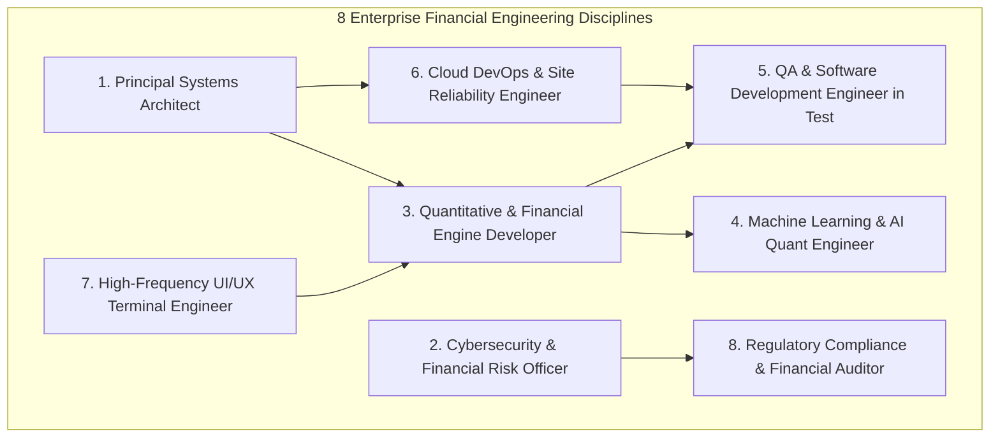

# Enterprise FinTech Architecture & Organizational Role Matrix — StockAI

**Document Status:** Production Reference & Engineering Roadmap  
**Scope:** Complete enumeration of professional modules, engineering roles, and test/maintenance pipelines required for Tier-1 financial institutions (e.g. Zerodha, Bloomberg, TradingView, QuantConnect, Citadel Securities).  
**Tracking System:** Checkboxes `[x]` denote implemented & verified modules; `[ ]` denote roadmap & future expansions.

---

## 1. Executive Organizational Overview

Large-scale, mission-critical algorithmic trading and quantitative stock research platforms cannot be engineered by generic full-stack development alone. In production financial enterprises, applications are partitioned across **8 specialized engineering disciplines**, each responsible for distinct modules ranging from micro-level algorithms to macro-level distributed infrastructure:

---

## 2. Comprehensive Module Matrix (Micro to Macro)

### Role 1: Principal Systems Architect / System Designer
*Responsible for component decoupling, distributed concurrency, memory efficiency, fault isolation, and connection lifecycle.*

- [x] **MOD-ARCH-001 (Micro): Domain Event Bus (`backend/core/event_bus.py`)**  
  *Asynchronous, thread-safe publish-subscribe event dispatching decoupling financial transactions from downstream side-effects.*
- [x] **MOD-ARCH-002 (Micro): Typed Domain Event Models (`backend/core/event_bus.py`)**  
  *Immutable event schemas: `OrderPlacedEvent`, `OrderExecutedEvent`, `OrderClosedEvent`, `MarketTickEvent`, `SystemAlertEvent`.*
- [x] **MOD-ARCH-003 (Meso): State-Machine Circuit Breakers (`backend/core/circuit_breaker.py`)**  
  *Martin Fowler / Netflix Hystrix pattern (`CLOSED`, `OPEN`, `HALF_OPEN`) shielding Fyers Broker API and Yahoo Market Data from cascade collapse.*
- [x] **MOD-ARCH-004 (Meso): L1 Process-Memory Microsecond LRU Cache (`backend/core/cache_manager.py`)**  
  *Bounded, thread-safe in-memory cache with explicit per-key TTL for high-frequency price quotes.*
- [x] **MOD-ARCH-005 (Meso): Single-Flight Request Coalescing Mutex (`backend/core/cache_manager.py`)**  
  *Eliminates the "Thundering Herd" / cache stampede problem on market opens by coalescing concurrent origin queries into a single coroutine.*
- [x] **MOD-ARCH-006 (Macro): Multi-Tier Distributed Cache Pipeline (`backend/core/cache_manager.py`)**  
  *Hierarchical fallback from L1 In-Memory -> L2 Redis Async -> Primary Database / Broker API.*
- [x] **MOD-ARCH-007 (Macro): Coordinated Graceful Lifespan Management (`backend/core/lifecycle.py`)**  
  *Clean ASGI lifespan hooking: captures SIGTERM/SIGINT, signals unreadiness, drains in-flight trades, and disposes Neon DB and Redis connection pools.*
- [x] **MOD-ARCH-008 (Macro): Deterministic Accounting Reconciliation (`backend/services/volume_profile.py`)**  
  *Mathematical invariant enforcement ensuring aggregate total volume identically matches the exact sum of distributed child price bins.*
- [ ] **MOD-ARCH-009 (Macro - Roadmap): Event-Sourced Order Ledger**  
  *Append-only transaction journal (EventStore / Kafka) enabling deterministic state reconstitution from zero.*

---

### Role 2: Cybersecurity & FinTech Risk Officer (InfoSec / SecOps)
*Responsible for theft prevention, order risk guardrails, DDoS mitigation, identity security, and regulatory auditability.*

- [x] **MOD-SEC-001 (Micro): Input Regex Sanitization & Injection Defense (`backend/services/paper_trading.py`)**  
  *Strict symbol validation preventing XSS, SQL injection, and path traversal in market queries.*
- [x] **MOD-SEC-002 (Micro): Password Complexity & Entropy Enforcement (`backend/core/auth_security.py`)**  
  *Enforces minimum 8 characters, alphanumeric distribution, and special character presence.*
- [x] **MOD-SEC-003 (Meso): Multi-Tier Token Bucket Rate Limiter (`backend/core/rate_limiter.py`)**  
  *Token bucket replenishment across 4 distinct operational tiers: `AUTH` (10/min), `TRADING` (30/min), `AI` (30/min), and `GENERAL` (120/min).*
- [x] **MOD-SEC-004 (Meso): Automated Brute-Force Lockout Defense (`backend/core/auth_security.py`)**  
  *Tracks failed login attempts by IP/account; 5 consecutive failures triggers an automatic 15-minute lockout with HTTP 429.*
- [x] **MOD-SEC-005 (Meso): Financial Idempotency Key Manager (`backend/core/idempotency.py`)**  
  *Deduplicates concurrent `POST /api/paper-trades` requests using `Idempotency-Key` headers, preventing double-clicks and double-spending.*
- [x] **MOD-SEC-006 (Meso): Fat-Finger Circuit Breakers & Order Risk Bounds (`backend/services/paper_trading.py`)**  
  *Enforces a maximum order quantity of 50,000 shares, max notional value of ₹1 Crore, and ±30% maximum limit price deviation from market.*
- [x] **MOD-SEC-007 (Macro): OWASP Defensive Headers Middleware (`backend/core/security_middleware.py`)**  
  *Injects `X-Frame-Options: DENY`, `X-Content-Type-Options: nosniff`, HSTS, Referrer-Policy, and sensitive financial route `no-store` headers.*
- [x] **MOD-SEC-008 (Macro): Denial of Service (DoS) 1MB Payload Guard (`backend/core/security_middleware.py`)**  
  *Rejects oversized request bodies exceeding 1 MB with `HTTP 413 Payload Too Large` to prevent memory exhaustion.*
- [x] **MOD-SEC-009 (Macro): Structured Immutable Audit Logger with Redaction (`backend/core/audit_logger.py`)**  
  *Records all financial, authentication, and security incidents into `logs/security_audit.log` with automatic secret redaction (`[REDACTED]`).*
- [x] **MOD-SEC-010 (Macro): Anti-Information Leakage Error Masking (`backend/main.py`)**  
  *Intercepts 500 exceptions and returns sanitized error payloads with unique `trace_id`, preventing database connection string leaks.*
- [ ] **MOD-SEC-011 (Macro - Roadmap): Multi-Factor Authentication (MFA / TOTP)**  
  *Time-based one-time password (RFC 6238) integration for live trading authorization.*

---

### Role 3: Quantitative & Financial Engine Developer
*Responsible for market data ingestion, algorithmic indicators, market structure, order execution, and options pricing.*

- [x] **MOD-QNT-001 (Micro): Indicator Computation Engine (`backend/services/indicators.py`)**  
  *High-precision calculation of RSI, MACD, EMA (9/21/50/200), Supertrend, ATR, and Bollinger Bands.*
- [x] **MOD-QNT-002 (Micro): Anchored VWAP Math Engine (`backend/services/indicators.py`)**  
  *Point-in-time Anchored Volume Weighted Average Price computed from user-designated chart timestamps.*
- [x] **MOD-QNT-003 (Meso): Volume Profile & Value Area Calculation (`backend/services/volume_profile.py`)**  
  *Generates Point of Control (POC), Value Area High (VAH), and Value Area Low (VAL) across 15+ dynamic price bins.*
- [x] **MOD-QNT-004 (Meso): Smart Money Concepts (SMC) & Market Structure (`backend/services/smc_engine.py`)**  
  *Identifies institutional Bullish/Bearish Order Blocks (OB), Fair Value Gaps (FVG), Liquidity Pools, and BOS/CHoCH.*
- [x] **MOD-QNT-005 (Meso): Options Chain Pricing & Greeks Engine (`backend/services/options_engine.py`)**  
  *Black-Scholes analytical option pricing with implied volatility (IV) and first/second order Greeks (Delta, Gamma, Theta, Vega).*
- [x] **MOD-QNT-006 (Macro): Real-Time Market Data Ingestion & Normalization (`backend/services/market_data.py`)**  
  *Fyers API v3 WebSocket tick ingestion with automatic dual-listed ticker normalization (`NSE:RELIANCE-EQ` <-> `RELIANCE.NS`).*
- [x] **MOD-QNT-007 (Macro): High-Speed Parallel Batch Quote Engine (`backend/services/market_data.py`)**  
  *Sub-300ms bulk quote fetching across 50+ tickers using async gather and zero-downtime Yahoo fallback.*
- [x] **MOD-QNT-008 (Macro): Algorithmic Paper Trading & Position Ledger (`backend/services/paper_trading.py`)**  
  *Simulates live market/limit fills, commission deductions, realized/unrealized P&L, and margin tracking.*
- [ ] **MOD-QNT-009 (Macro - Roadmap): Live Broker DMA Gateway (Fyers Order API)**  
  *Direct Market Access (DMA) live execution adapter with pre-trade compliance checks.*

---

### Role 4: Machine Learning & AI Quant Engineer
*Responsible for quantitative feature engineering, multi-cap training, walk-forward validation, and inference speed.*

- [x] **MOD-ML-001 (Micro): Walk-Forward Feature Engineering Pipeline (`backend/services/ai_engine.py`)**  
  *Extracts 35+ quantitative features: momentum, volatility, volume ratios, candle wicks, and macro trend signals.*
- [x] **MOD-ML-002 (Meso): Multi-Cap LightGBM Gradient Boosting Models (`backend/models/`)**  
  *Trained across 274,052 historical samples (150+ NSE/BSE stocks, 2015-2026):*
  - `backend/models/lgb_model_largecap.txt` (131,989 samples, 72 LargeCap tickers)
  - `backend/models/lgb_model_smallcap.txt` (142,063 samples, 78 Mid/Small/Penny tickers)
- [x] **MOD-ML-003 (Meso): Model Interpretability & Explainability Engine (`backend/services/ai_engine.py`)**  
  *SHAP value decomposition providing feature attribution for individual stock predictions.*
- [x] **MOD-ML-004 (Macro): Dynamic Model Hot-Reloading & Low-Latency Inference (`backend/services/ai_engine.py`)**  
  *Loads trained tree models into memory with sub-50ms inference time and automatic market regime conditioning.*
- [ ] **MOD-ML-005 (Macro - Roadmap): Transformer / LSTM Sequential Price Forecaster**  
  *Deep learning temporal models for multi-horizon price sequence prediction.*

---

### Role 5: Quality Assurance (QA) & SDET (Software Development Engineer in Test)
*Responsible for test harnesses, financial simulation fidelity, regression automation, and failure verification.*

- [x] **MOD-QA-001 (Micro): Quantitative Indicator Unit Verification (`backend/tests/test_indicators.py`)**  
  *8 unit tests validating mathematical correctness of RSI, MACD, Anchored VWAP, and ATR.*
- [x] **MOD-QA-002 (Micro): Volume Profile Invariant Test Suite (`backend/tests/test_volume_profile.py`)**  
  *8 unit tests asserting POC, VAH, VAL, and exact mathematical sum equality across bins.*
- [x] **MOD-QA-003 (Meso): Cybersecurity & Threat Defense Test Harness (`backend/tests/test_cybersecurity.py`)**  
  *15 automated tests verifying token bucket refill, idempotency deduplication, fat-finger rejection, brute-force lockout, and error sanitization.*
- [x] **MOD-QA-004 (Meso): Distributed System Design Test Harness (`backend/tests/test_system_design.py`)**  
  *9 automated tests verifying domain event dispatch, circuit breaker state machine transitions, L1 cache TTL, and single-flight coalescing.*
- [x] **MOD-QA-005 (Macro): Full Backend Regression Test Suite (`backend/tests/`)**  
  *64 automated tests executing across all backend modules in 30.69 seconds (100% green).*
- [x] **MOD-QA-006 (Macro): Frontend Static Type & Lint Verification (`frontend/`)**  
  *TypeScript and ESLint verification passing with 0 errors and 0 warnings.*
- [x] **MOD-QA-007 (Macro): Production Bundle Optimization Verification (`frontend/`)**  
  *Vite production build transforming 1,979 modules with exit code 0.*
- [ ] **MOD-QA-008 (Macro - Roadmap): High-Concurrency Load & Stress Testing (Locust / k6)**  
  *Simulating 1,000+ simultaneous WebSocket tick connections and high-volume trade submissions.*
- [ ] **MOD-QA-009 (Macro - Roadmap): End-to-End Automated Browser Testing (Playwright)**  
  *Headless browser verification of user trade execution, chart rendering, and toast alerts.*

---

### Role 6: Cloud DevOps & Site Reliability Engineer (SRE)
*Responsible for containerization, production blueprints, telemetry scraping, health probes, and zero-downtime releases.*

- [x] **MOD-OPS-001 (Micro): Production Docker Base & Non-Root Hardening (`backend/Dockerfile`)**  
  *Multi-stage Debian slim container executing under unprivileged `appuser` (UID 1000) with curl health checks.*
- [x] **MOD-OPS-002 (Meso): Full-Stack Container Orchestration (`docker-compose.yml`)**  
  *Coordinated services: `stockbackend`, `stockcelery`, `stockbeat`, `stockflower`, `stockfrontend`, `stockdb` (TimescaleDB), and `stockredis`.*
- [x] **MOD-OPS-003 (Meso): OpenMetrics / Prometheus Telemetry Scrape Engine (`backend/core/telemetry.py`)**  
  *Exposes standard Prometheus `/metrics` tracking request latency histograms, trade counts, rate limit blocks, and circuit breaker states.*
- [x] **MOD-OPS-004 (Meso): Kubernetes Liveness & Deep Readiness Probes (`backend/core/telemetry.py`)**  
  *`/health/live` (process responsiveness) and `/health/ready` (active Neon Postgres and Redis latency checks).*
- [x] **MOD-OPS-005 (Macro): Cloud Infrastructure Blueprints (`render.yaml` & `vercel.json`)**  
  *Infrastructure as Code (IaC) defining cloud backend worker instances and frontend edge CDN routing.*
- [x] **MOD-OPS-006 (Macro): Database Connection Pool Tuning (Neon Serverless PostgreSQL)**  
  *AsyncPg connection pooling configured for Neon pooled endpoints (`-pooler`) with SSL enforcement.*
- [ ] **MOD-OPS-007 (Macro - Roadmap): Centralized Log Aggregation (Grafana Loki / Vector)**  
  *Automated ingestion of `logs/security_audit.log` into cloud observability backends.*
- [ ] **MOD-OPS-008 (Macro - Roadmap): Automated Canary / Blue-Green Deployments**  
  *Traffic splitting and zero-downtime rolling updates on Kubernetes / ECS.*

---

### Role 7: High-Frequency UI/UX Trading Terminal Specialist
*Responsible for 60fps charting, real-time WebSocket state reconciliation, drawing tools, and vector exports.*

- [x] **MOD-UI-001 (Micro): Smooth Numerical Motion System (`frontend/src/components/AnimatedNumber.tsx`)**  
  *Physics-based counter animations for tick updates and P&L changes.*
- [x] **MOD-UI-002 (Micro): Global Non-Blocking Toast Notification Center (`frontend/src/components/Toast.tsx`)**  
  *Thread-safe notification dispatch across the application for system and trade alerts.*
- [x] **MOD-UI-003 (Meso): High-Performance Financial Charting Engine (`frontend/src/pages/ChartPage.tsx`)**  
  *Lightweight Charts canvas rendering: multi-timeframe candles, Order Blocks, Heikin-Ashi, and indicator sub-panels.*
- [x] **MOD-UI-004 (Meso): Interactive Anchored VWAP Drawing Tool (`frontend/src/pages/ChartPage.tsx`)**  
  *Click-to-anchor interactive tool enabling traders to anchor VWAP to specific swing highs/lows.*
- [x] **MOD-UI-005 (Meso): Real-Time WebSocket Candlestick Streamer (`frontend/src/pages/ChartPage.tsx`)**  
  *Consumes live 1-second ticks, dynamically updating candle bodies, wicks, and indicators in real time.*
- [x] **MOD-UI-006 (Meso): Horizontal Volume Profile Histogram Overlay (`frontend/src/pages/ChartPage.tsx`)**  
  *Renders price-volume distribution directly beside chart price axes with POC, VAH, and VAL callouts.*
- [x] **MOD-UI-007 (Macro): Institutional Vector PDF Report Generator (`frontend/src/pages/ChartPage.tsx`)**  
  *Client-side PDF compilation utilizing `jsPDF` and `html2canvas` generating branded research reports.*
- [x] **MOD-UI-008 (Macro): Interactive Candlestick Pattern Alert Builder (`frontend/src/pages/AlertsPage.tsx`)**  
  *Dynamic alert configuration UI supporting technical threshold and candlestick pattern conditions.*
- [ ] **MOD-UI-009 (Macro - Roadmap): Multi-Chart Grid Layout (2x2 / 4x4 Viewports)**  
  *Simultaneous multi-stock monitoring dashboard with synchronized crosshairs.*

---

### Role 8: Regulatory Compliance & Financial Risk Auditor
*Responsible for legal disclaimers, audit trail retention, trade reconciliation, and data privacy.*

- [x] **MOD-CMP-001 (Micro): Non-Financial Advice Disclaimers & Timestamping (`frontend/src/pages/ChartPage.tsx`)**  
  *Mandatory disclosures stating that AI outputs represent mathematical probabilities, not financial advice.*
- [x] **MOD-CMP-002 (Meso): Immutable Forensic Audit Log (`logs/security_audit.log`)**  
  *Structured JSON logging of all trading actions, risk limit rejections, and authentication events.*
- [x] **MOD-CMP-003 (Macro): Zero-Divergence Ledger Reconciliation (`backend/services/paper_trading.py`)**  
  *Guarantees cash balance, margin used, realized P&L, and unrealized P&L strictly balance without leakage.*
- [ ] **MOD-CMP-004 (Macro - Roadmap): Automated End-of-Day (EOD) Regulatory Contract Notes**  
  *Generates daily SEBI/SEC-compliant transaction summaries for all executed simulated trades.*
